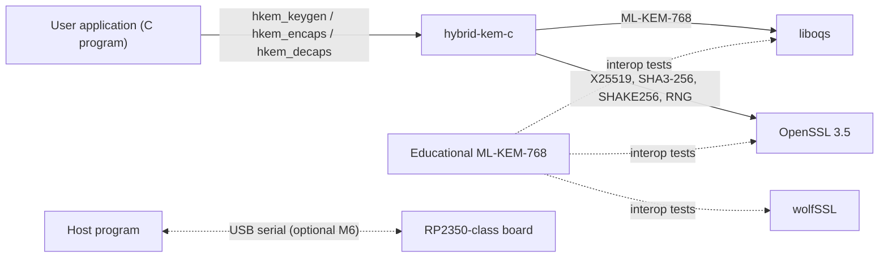

# hybrid-kem-c: Concept of Operations (CONOPS)

Version 0.1 (draft), November 2026. Author: ion-.

## 1. Purpose and scope

This Concept of Operations (CONOPS) describes who uses `hybrid-kem-c`, how and in what setting. `hybrid-kem-c` is a small C11 library and set of example programs for X-Wing, a hybrid key encapsulation mechanism (KEM) that combines the classical X25519 key exchange with the post-quantum ML-KEM-768 (Module-Lattice-Based Key-Encapsulation Mechanism), specified in an Internet Engineering Task Force (IETF) Internet-Draft ([S1](SOURCES.md#s1)). Two parties use it to agree a 32-byte shared secret that stays secure as long as either component holds.

The project has three parts:

- an X-Wing library built on liboqs (Open Quantum Safe) and OpenSSL 3.5, with a small, fixed-size C application programming interface (API);
- a from-scratch, educational ML-KEM-768 written to be read alongside FIPS 203 (Federal Information Processing Standard 203, [S2](SOURCES.md#s2));
- an optional port to a microcontroller board, talking to a host over USB (Universal Serial Bus) serial.

Requirements are in [SRS.md](SRS.md), interfaces in [ICD.md](ICD.md), verification in [VERIFICATION.md](VERIFICATION.md), technical risks in [RISKS.md](RISKS.md) and sources in [SOURCES.md](SOURCES.md).

## 2. Users

| User | What they want |
|---|---|
| Developers evaluating hybrid KEMs | Drop a small, tested X-Wing into a C program and see its sizes, formats and measured performance. |
| Learners | Step through a readable ML-KEM-768 that maps line by line onto FIPS 203. |
| Interoperability (interop) testers | Reproducible, derandomized outputs to compare against other ML-KEM and X-Wing implementations. |

## 3. Operational scenarios

**SC1. Using the library in a C program.** A developer links `hybrid-kem-c`, liboqs and OpenSSL. The receiver calls `hkem_keygen` and publishes the 1216-byte public key. The sender calls `hkem_encaps` with it and sends back the 1120-byte ciphertext. The receiver calls `hkem_decaps` with its 32-byte secret seed and gets the same 32-byte shared secret, which the application feeds into its own key derivation. Transport and authentication of the keys are up to the application.

**SC2. A learner stepping through the from-scratch ML-KEM.** A learner builds the educational ML-KEM-768, runs it with seeded inputs from the NIST (National Institute of Standards and Technology) ACVP (Automated Cryptographic Validation Protocol) test vectors ([S5](SOURCES.md#s5)), and steps through key generation, encapsulation and decapsulation in a debugger, matching each function to its FIPS 203 algorithm. The README states plainly that this code is not constant-time and not for production.

**SC3. Interop testing against OpenSSL and wolfSSL.** A tester runs the derandomized entry points with fixed seeds and checks the outputs against the X-Wing draft's test vectors ([S1](SOURCES.md#s1)), and runs the ML-KEM-768 cross-checks in both directions against liboqs, OpenSSL 3.5's native ML-KEM and wolfSSL's ML-KEM.

**SC4. Optional board use over USB serial.** A user flashes the educational ML-KEM-768 plus X25519 onto an RP2350-class board, connects it to a host over USB serial, and runs a host program that completes an X-Wing key exchange with the board. Both sides print the same shared secret, and the README reports the board's timings, stack use and code size. The serial protocol is still to be defined.

## 4. System context

RNG = random number generator. SHA3-256 and SHAKE256 are from the Secure Hash Algorithm 3 (SHA-3) family ([S4](SOURCES.md#s4)).

## 5. Constraints and assumptions

- Plain C11, built with CMake, strict warnings and sanitizers.
- Pinned dependencies: liboqs 0.16.0 ([S6](SOURCES.md#s6)), OpenSSL 3.5.9 ([S7](SOURCES.md#s7)) and wolfSSL 5.9.4 ([S8](SOURCES.md#s8)) (interop only), and X-Wing draft -11 ([S1](SOURCES.md#s1)). Drafts can change; the pin is re-checked at each milestone review.
- The X-Wing library relies on liboqs and OpenSSL for every operation on secret data and records each primitive's documented constant-time status; it makes no stronger side-channel claim than the libraries do.
- Security assumes that ML-KEM-768 or X25519 holds, and that SHA3-256 and SHAKE256 are secure. Binding properties are as claimed by the draft, whose proof reference is still marked TODO.
- The optional board needs a few hundred kilobytes (KB) of RAM (random-access memory); the 2400-byte ML-KEM-768 decapsulation key alone rules out boards such as the ATmega328P (2 KB).

## 6. Out of scope

- Production use of the educational ML-KEM-768, which is not constant-time and not hardened.
- Authentication and signatures (this is a KEM only), and transport protocols.
- Side-channel resistance of the underlying libraries, and a constant-time test harness.
- Other ML-KEM parameter sets, ML-DSA (Module-Lattice-Based Digital Signature Algorithm) and performance optimisation.
- Packaging or distributing the library for production deployments.
